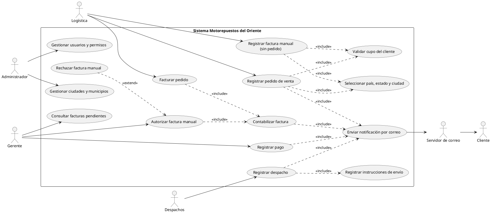

# Actividad 2 · Consultoría cruzada (tipos de requerimiento)

Este documento cubre la **Fase 3** de la actividad: redactar y clasificar los requerimientos descubiertos, modelar los casos de uso y diseñar un plan de calidad específico. Se integran las dos tarjetas confidenciales, porque ambas describen necesidades de Motorepuestos del Oriente.

## 1. Requerimientos descubiertos y su clasificación

| # | Requerimiento (redactado por la agencia) | Tipo | Justificación de la clasificación |
|---|---|---|---|
| A1 | El sistema enviará un correo electrónico al cliente cuando se registre un **pedido de venta**, un **despacho de mercancía**, la **emisión de una factura** o el **registro de un pago**. | **Funcional** (notificación) | Describe *qué hace* el sistema ante un evento de negocio. |
| A2 | El sistema operará adecuadamente con hasta **100.000 usuarios en sesiones concurrentes**. | **No funcional de rendimiento** (capacidad y escalabilidad, ISO 25010: eficiencia de desempeño) | No agrega una función: restringe *cómo de bien* deben funcionar todas. |
| A3 | La aplicación web tendrá diseño **responsive** para computadores, tabletas y teléfonos inteligentes. | **No funcional de usabilidad / portabilidad** (adaptabilidad) | Es una cualidad de la interfaz, no un servicio nuevo. |
| A4 | El tiempo en falla del sistema **no superará el 0,5 %** del tiempo total de operación. | **No funcional de fiabilidad** (disponibilidad ≥ 99,5 %) | Mide la continuidad del servicio. |
| B1 | El procedimiento de desarrollo estará definido explícitamente en **manuales de procedimientos** y cumplirá con **ISO 9000**. | **Restricción de proceso** (organizacional, norma de calidad) | Restringe *cómo se construye* el software, no cómo se comporta. |
| B2 | El sistema permitirá registrar **facturas manuales no asociadas a pedidos**; estas requerirán **autorización del grupo de Gerentes antes de contabilizarse**. | **Funcional** (con regla de negocio) | Define un servicio y la regla que lo condiciona. |
| B3 | Estado y ciudad o municipio serán **listas de preselección**: solo se muestran los estados del país elegido y solo las ciudades **registradas en su funcionalidad** de administración. | **Funcional de interfaz** con **restricción de integridad de datos** | Define el comportamiento de captura y evita datos libres inconsistentes. |
| B4 | Las páginas cumplirán la **ley de tratamiento en condiciones de igualdad para personas con discapacidad**. | **Restricción legal** (que se concreta en requisitos no funcionales de accesibilidad) | Su origen es una norma obligatoria. |

**Normas aplicables a B4 en Colombia:** Ley 1346 de 2009 (aprueba la Convención de la ONU sobre los derechos de las personas con discapacidad), Ley Estatutaria 1618 de 2013 (acceso a la información y las comunicaciones en igualdad de condiciones), Resolución MinTIC 1519 de 2020, anexo 1 (estándares de accesibilidad web basados en WCAG 2.1 nivel AA) y NTC 5854.

### Cálculo del requisito A4
0,5 % de un mes de 30 días = 0,005 × 720 h = **3,6 horas como máximo fuera de servicio al mes** (unos 43 minutos por semana).

## 2. Casos de uso

Diagrama en PlantUML. Pégalo en <https://www.plantuml.com/plantuml> para exportarlo como imagen.



**Diferencia clave con el diagrama anterior:** la factura que nace de un pedido se contabiliza directamente (*Facturar pedido* incluye *Contabilizar*). Solo la factura manual pasa por *Autorizar factura manual*. El caso *Enviar notificación por correo* se incluye en las cuatro transacciones de la tarjeta A.

## 3. Plan de calidad específico

| Req. | Qué se valida | Técnica y herramienta | Criterio de aceptación |
|---|---|---|---|
| A1 | Que cada una de las 4 transacciones genere su correo | Prueba funcional por transacción; en producción, buzón de pruebas (MailHog o Mailtrap) | 4 de 4 transacciones generan correo con destinatario, asunto y número de documento correctos |
| A2 | Capacidad con 100.000 sesiones concurrentes | Prueba de carga con **k6** (script abajo) en ambiente igual al de producción, rampa por etapas | p95 del tiempo de respuesta < 2 s y tasa de errores < 1 % sostenida 30 min con 100.000 usuarios virtuales |
| A3 | Visualización correcta en varios dispositivos | Matriz de dispositivos: 360, 390, 768, 1024, 1440 px; Chrome, Safari, Firefox; pruebas automáticas con Playwright | Sin desplazamiento horizontal ni contenido cortado en ninguna combinación |
| A4 | Tiempo en falla ≤ 0,5 % | Monitoreo externo cada minuto (UptimeRobot o similar) durante 30 días; registro de incidentes con MTBF y MTTR | Disponibilidad = tiempo arriba ÷ tiempo total ≥ 99,5 % |
| B1 | Cumplimiento del procedimiento ISO 9000 | Auditoría interna con la lista de chequeo de `manual-procedimientos.md` | Todos los registros de cada fase existen y están aprobados |
| B2 | Autorización antes de contabilizar | Pruebas de regla de negocio: (1) factura de pedido queda contabilizada; (2) factura manual queda pendiente sin asiento; (3) quien la registró no puede autorizarla | Los 3 casos se comportan como se describe |
| B3 | Listas filtradas e integridad | Cambiar de país y verificar estados; intentar una ciudad no registrada | Solo aparecen estados del país; no se puede escribir ciudad libre |
| B4 | Cumplimiento de la ley de discapacidad | Auditoría automática (**axe DevTools**, **Lighthouse**) y manual: recorrido solo con teclado, lector de pantalla **NVDA**, zoom al 200 %, contraste con **WebAIM Contrast Checker**; prueba con al menos un usuario con discapacidad | 0 errores críticos de axe; Lighthouse accesibilidad ≥ 95; criterios WCAG 2.1 AA verificados en lista de chequeo |

### Script de carga para A2 (k6)

```javascript
// Ejecutar: k6 run --out json=resultado.json carga.js
import http from 'k6/http';
import { check, sleep } from 'k6';

export const options = {
  stages: [
    { duration: '10m', target: 10000 },
    { duration: '10m', target: 50000 },
    { duration: '10m', target: 100000 },
    { duration: '30m', target: 100000 },   // sostener la carga máxima
    { duration: '5m',  target: 0 },
  ],
  thresholds: {
    http_req_duration: ['p(95)<2000'],     // 95 % de las respuestas en menos de 2 s
    http_req_failed:   ['rate<0.01'],      // menos de 1 % de errores
  },
};

const API = __ENV.API || 'https://staging.motorepuestosoriente.example/api';

export default function () {
  const r1 = http.get(`${API}/facturas?estado=Pendiente`);
  check(r1, { 'consulta 200': r => r.status === 200 });
  sleep(Math.random() * 3 + 2);            // tiempo de "pensar" de un usuario real
  const r2 = http.get(`${API}/productos?buscar=cadena`);
  check(r2, { 'búsqueda 200': r => r.status === 200 });
  sleep(Math.random() * 3 + 2);
}
```

Generar 100.000 usuarios virtuales requiere varias máquinas generadoras de carga (k6 en modo distribuido o k6 Cloud). Una sola máquina sostiene del orden de 30.000 a 40.000.

### Arquitectura propuesta para cumplir A2 y A4

```
Usuarios ─► CDN (interfaz estática) ─► Balanceador de carga (2 zonas)
                                          │
                     ┌────────────────────┼────────────────────┐
                 API sin estado       API sin estado       API sin estado   ← autoescalado
                     └──────────┬─────────┴──────────┬─────────┘
                          Redis (sesiones)     Cola de mensajes ─► Servicio de correo (A1)
                                │
                 PostgreSQL principal ──réplica──► Réplicas de lectura
                                │
                       Respaldos diarios + registro de transacciones
```

- **Sin estado en la API:** cualquier instancia atiende cualquier petición; se agregan instancias al subir la carga.
- **Dos zonas de disponibilidad:** si una falla, la otra sigue atendiendo (A4).
- **Cola para los correos:** si el servidor de correo falla, las transacciones no se detienen y los correos se reintentan (A1 y A4).
- **Verificación de salud cada minuto** con alerta al equipo para mantener el tiempo de reparación por debajo del presupuesto de 3,6 h al mes.

## 4. Autoevaluación según los criterios de la Fase 4

| Criterio | Resultado |
|---|---|
| ¿Se extrajeron los 4 puntos de cada tarjeta? | Sí: A1–A4 y B1–B4 están redactados en la sección 1. |
| ¿Se clasificó correctamente cada tipo? | Funcionales: A1, B2, B3. No funcionales: A2 (rendimiento), A3 (usabilidad/portabilidad), A4 (fiabilidad). Restricciones: B1 (proceso), B4 (legal). |
