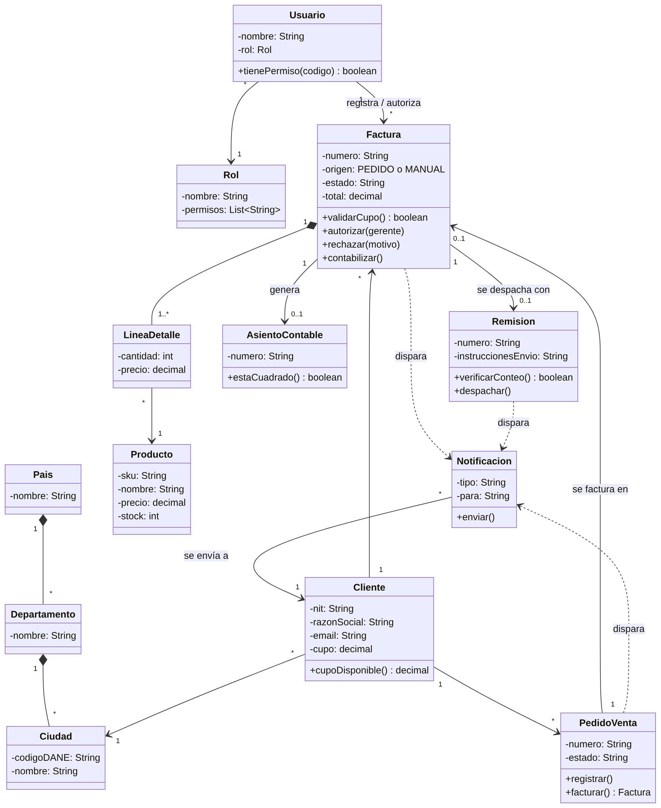

# Fase 1 · Modelo orientado a objetos

**Actividad 4 · Del requisito al backlog** · Sistema Motorepuestos del Oriente

## Diagrama de clases (versión básica)

La versión completa, con 24 clases (pagos, novedades, existencias por sucursal, auditoría, enumeraciones), está en [`diagrama-clases-completo.png`](diagrama-clases-completo.png). Las fuentes editables son los archivos `.mmd` (Mermaid): se pueden abrir y modificar en <https://mermaid.live>.

## Clases principales

| Clase | Responsabilidad | Requisito que atiende |
|---|---|---|
| `Usuario`, `Rol` | Identificar a quien usa el sistema y qué puede hacer | B2 (solo gerentes autorizan), seguridad |
| `Pais` → `Departamento` → `Ciudad` | Catálogo jerárquico para las listas de preselección | **B3** |
| `Cliente` | Datos del comprador, correo y cupo de crédito | A1 (correo), validación de cupo |
| `Producto` | Repuesto con precio y existencias | Inventario |
| `PedidoVenta` | Pedido confirmado por el cliente; se convierte en factura | **B2** (facturas asociadas a pedidos) |
| `Factura` | Documento de venta con origen PEDIDO o MANUAL | **B2** |
| `LineaDetalle` | Cada repuesto y cantidad de un pedido o factura | Control de cantidades (fraude) |
| `AsientoContable` | Registro contable generado al contabilizar | **B2** (contabilizar después de autorizar) |
| `Remision` | Despacho con instrucciones de envío y conteo ciego | A1, fraude en despachos |
| `Notificacion` | Correo al cliente por cada transacción | **A1** |

## Cómo interactúan para cumplir las reglas de negocio

**Regla B2: factura manual con autorización antes de contabilizar**
1. `Factura` se crea con `origen = MANUAL` y `estado = PENDIENTE`.
2. `Factura.validarCupo()` consulta `Cliente.cupoDisponible()`.
3. Un `Usuario` con `Rol` Gerente, distinto de quien la registró, llama a `Factura.autorizar(gerente)`.
4. Solo entonces `Factura.contabilizar()` crea el `AsientoContable`.
5. Si se rechaza, `Factura.rechazar(motivo)` la cierra sin asiento.

**Facturas desde pedido**
`PedidoVenta.facturar()` crea una `Factura` con `origen = PEDIDO`, que se contabiliza de inmediato.

**Regla B3: listas de preselección**
`Pais` contiene `Departamento`s y estos contienen `Ciudad`es (composición). La interfaz solo ofrece los departamentos del país elegido y las ciudades registradas de ese departamento, así que no se pueden escribir ciudades libres.

**Regla A1: correos por transacción**
`PedidoVenta`, `Factura`, `Remision` y el pago **disparan** (dependencia) una `Notificacion`, que se envía al correo del `Cliente`.

## Conceptos de orientación a objetos aplicados

| Concepto | Ejemplo en el modelo |
|---|---|
| **Abstracción** | `Factura` representa solo lo esencial del documento: número, origen, estado y total |
| **Encapsulamiento** | Atributos privados (`-`); el estado de la factura solo cambia mediante `autorizar()`, `rechazar()` o `contabilizar()` |
| **Composición** | Una `Factura` se compone de `LineaDetalle`s: si se elimina la factura, sus líneas no existen solas |
| **Asociación con multiplicidad** | Un `Cliente` tiene muchas (`*`) facturas; una factura tiene 0 o 1 remisión (`0..1`) |
| **Dependencia** | `Factura ..> Notificacion`: la factura usa el servicio de notificación sin contenerlo |
| **Modularidad** | Cada clase corresponde a un módulo del sistema (pedidos, facturas, despachos…) |
