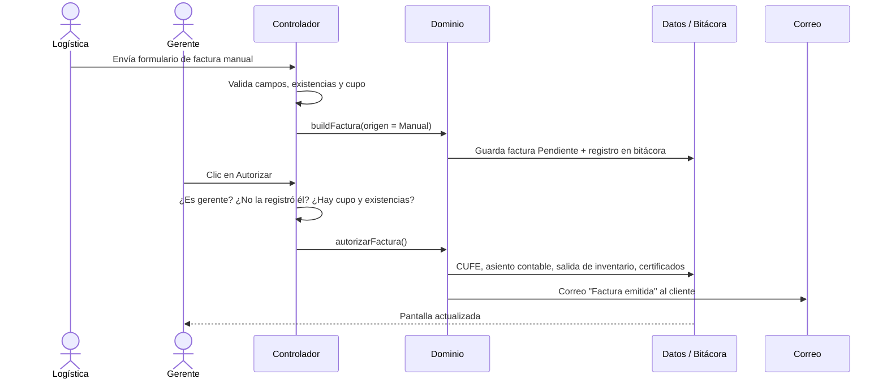

# Documento de arquitectura de software

**Proyecto:** Sistema Motorepuestos del Oriente · **Versión:** 2.0 · **Asignatura:** Ingeniería de Software III

## 1. Resumen

| Aspecto | Decisión |
|---|---|
| Tipo de aplicación | Aplicación web de una sola página (SPA, *Single Page Application*) |
| Estilo arquitectónico | **Arquitectura en capas** con separación **Modelo–Vista–Controlador (MVC)** |
| Modularidad | 28 módulos JavaScript + 1 hoja de estilos, organizados en 6 capas, con dependencias en un solo sentido |
| Tecnologías | HTML5, CSS3 (variables CSS), JavaScript ES2020 sin frameworks |
| Persistencia | Prototipo: almacenamiento del navegador (localStorage). Producción: API REST + PostgreSQL (`modelo-datos.sql`) |
| Metodología | Proceso **incremental con prototipado evolutivo**, requisitos según IEEE 830 y procedimiento conforme con ISO 9001 (`manual-procedimientos.md`) |
| Calidad | Modelo ISO/IEC 25010; accesibilidad WCAG 2.1 AA |

## 2. Metodología de desarrollo

Se usó un **modelo incremental con prototipado evolutivo**: cada incremento produce una versión funcional que se valida con el cliente y se amplía en la siguiente. Se eligió porque los requisitos se fueron descubriendo por etapas (entrevista, luego consultoría cruzada) y un prototipo navegable es la forma más rápida de validarlos.

| Incremento | Entrada | Resultado |
|---|---|---|
| 1. Prototipo base | Entrevista con Motorepuestos del Oriente y diagrama de casos de uso | Facturación manual con autorización, despachos con conteo ciego, inventario, importaciones, certificados, trazabilidad, accesibilidad |
| 2. Consultoría cruzada | Tarjetas A y B (actividad 2) | Pedidos de venta, contabilización automática, notificaciones por correo, catálogo de departamentos, manual ISO 9000 |
| 3. Modularización | Revisión de mantenibilidad | Código dividido en capas y módulos; documento de arquitectura |
| 4. Producción (propuesto) | Aceptación del prototipo | API REST, PostgreSQL, despliegue escalable (sección 9) |

Cada incremento siguió las fases del manual de procedimientos: requisitos, diseño, construcción, verificación (pruebas automáticas con Playwright) y validación.

## 3. Estilo arquitectónico: capas + MVC

```
┌──────────────────────────────────────────────────────────────────┐
│  PRESENTACIÓN (Vista)                                            │
│  js/vistas/*.js  ·  js/ui/*.js  ·  css/estilos.css               │
│  Funciones que reciben el estado y devuelven HTML                │
├──────────────────────────────────────────────────────────────────┤
│  CONTROL (Controlador)                                           │
│  js/controladores/eventos.js → acciones.js / formularios.js      │
│  Recibe eventos del usuario, valida y llama al dominio           │
├──────────────────────────────────────────────────────────────────┤
│  DOMINIO (Modelo: reglas de negocio)                             │
│  js/dominio/reglas-negocio.js                                    │
│  Facturar, autorizar, contabilizar, cupo, remisiones, correos    │
├──────────────────────────────────────────────────────────────────┤
│  DATOS (Modelo: estado y persistencia)                           │
│  js/datos/*.js                                                   │
│  Estado, bitácora encadenada, datos de ejemplo, guardar/cargar   │
├──────────────────────────────────────────────────────────────────┤
│  NÚCLEO (transversal)                                            │
│  js/nucleo/utilidades.js · js/nucleo/seguridad.js                │
│  SHA-256, formatos, escape de HTML, roles y permisos             │
└──────────────────────────────────────────────────────────────────┘
          Cada capa solo usa las capas que están debajo de ella.
```

**Flujo de datos en un solo sentido:**

```
Usuario ─► evento (clic, envío de formulario)
        ─► Controlador: ¿tiene permiso? ¿los datos son válidos?
        ─► Dominio: aplica la regla de negocio (ej. autorizar factura)
        ─► Datos: modifica el estado + registra en la bitácora + guarda
        ─► Vista: se vuelve a dibujar la pantalla con el estado nuevo
```

Las vistas nunca modifican datos y los controladores nunca generan HTML. Esto hace que cada parte se pueda entender y probar por separado.

## 4. Módulos

| Capa | Módulo | Responsabilidad |
|---|---|---|
| Núcleo | `js/nucleo/utilidades.js` | SHA-256, formato de moneda (COP/USD) y fechas, escape de HTML, acceso seguro al almacenamiento |
| Núcleo | `js/nucleo/seguridad.js` | Catálogo de 14 permisos y permisos por rol (RBAC) |
| Datos | `js/datos/estado-y-auditoria.js` | Estado global, consecutivos, bitácora encadenada, CUFE, códigos de certificado |
| Datos | `js/datos/datos-ejemplo.js` | Datos de demostración: 14 productos, 7 clientes, 15 municipios DANE, 6 meses de historia |
| Datos | `js/datos/persistencia.js` | Cargar y guardar. **Único módulo que cambia al pasar a la base de datos real** |
| Dominio | `js/dominio/reglas-negocio.js` | Crear pedidos, facturas y remisiones; autorizar y contabilizar; cupo; notificaciones por correo |
| Presentación | `js/ui/navegacion.js` | Rutas, control de acceso por pantalla, armazón (menú, barra superior) |
| Presentación | `js/ui/accesibilidad.js` | Tamaño de texto, contraste, espaciado, tema, movimiento |
| Presentación | `js/ui/dialogos.js`, `js/ui/iconos.js` | Ventanas modales, avisos, iconos |
| Presentación | `js/vistas/*.js` (14 módulos) | Una pantalla por módulo: acceso, tablero, pedidos, facturas, autorizaciones, despachos, inventario, importaciones, clientes, trazabilidad, notificaciones, certificados, administración, calidad |
| Control | `js/controladores/eventos.js` | Delegación de eventos: un solo escuchador por tipo de evento para toda la app |
| Control | `js/controladores/acciones.js` | Acciones de botones (autorizar, facturar pedido, despachar…) |
| Control | `js/controladores/formularios.js` | Validación y guardado de formularios |
| Arranque | `js/app.js` | Registro de vistas e inicio |

Los módulos se cargan con etiquetas `<script>` clásicas en el orden de las capas (de abajo hacia arriba). No se usan módulos ES (`import`) para que la aplicación abra con doble clic desde el disco, sin servidor.

## 5. Patrones de diseño aplicados

| Patrón | Dónde | Para qué |
|---|---|---|
| **MVC** | Capas de vista, control y modelo | Separar presentación, lógica de interacción y reglas |
| **Enrutador por *hash*** (*front controller*) | `navegacion.js` | Una URL por pantalla (`#facturas`), con verificación de permisos antes de mostrarla |
| **Comando** | Mapas `ACT` y `FORM` | Cada botón o formulario declara el nombre de su comando (`data-act="autorizar"`); agregar una acción no toca el resto |
| **Delegación de eventos** | `eventos.js` | Un solo escuchador para miles de elementos dibujados dinámicamente |
| **Plantillas** | Vistas | HTML generado a partir del estado, siempre escapado con `esc()` contra inyección |
| **Control de acceso basado en roles (RBAC)** | `seguridad.js`, `P()` | Permisos configurables por rol desde Administración |
| **Segregación de funciones** | `acciones.js` | Quien registra una factura manual no puede autorizarla |
| **Registro de solo anexión con cadena de hashes** | `estado-y-auditoria.js` | Cada registro guarda la huella del anterior; una alteración rompe la cadena y se detecta |
| **Funciones puras para reglas** | `calcTotales`, `cupoDisponible`, `costeo` | Cálculos sin efectos secundarios, fáciles de probar |
| **Máquina de estados** | Pedido, factura, remisión, importación | Transiciones válidas explícitas (ej. una remisión no pasa a *En tránsito* sin estar *Verificada*) |

## 6. Secuencia de un caso de uso: factura manual



## 7. Seguridad

| Amenaza | Control |
|---|---|
| Acceso no autorizado a funciones | RBAC en la navegación y en cada acción |
| Fraude interno (facturar y autorizar la misma persona) | Segregación de funciones en la aplicación y restricción `CHECK` en la base de datos |
| Alteración de registros | Bitácora encadenada con SHA-256 y verificación de integridad; triggers que impiden modificar la bitácora |
| Alteración de facturas | CUFE recalculable; factura autorizada inmutable (trigger en PostgreSQL) |
| Inyección de código (XSS) | Todo dato del usuario pasa por `esc()` antes de mostrarse |
| Datos personales | Autorización de tratamiento obligatoria (Ley 1581 de 2012) |

## 8. Decisiones de arquitectura

| # | Decisión | Alternativas consideradas | Motivo |
|---|---|---|---|
| D1 | JavaScript sin frameworks | React, Angular, Vue | Cero dependencias y cero instalación: abre con doble clic, carga rápido y cualquier integrante entiende el código |
| D2 | SPA con rutas por *hash* | Varias páginas HTML | Navegación instantánea; funciona sin servidor |
| D3 | Scripts clásicos en lugar de módulos ES | `import`/`export` | Los módulos ES no cargan desde `file://`; así funciona sin servidor |
| D4 | Almacenamiento del navegador en el prototipo | Backend desde el inicio | Validar requisitos rápido; la persistencia está aislada en un solo módulo para migrar después |
| D5 | Bitácora encadenada | Bitácora simple | Responde al problema de fraude: no basta registrar, hay que detectar alteraciones |
| D6 | Tipografía Atkinson Hyperlegible | Tipografías genéricas | Diseñada para baja visión; apoya el requisito legal de accesibilidad |
| D7 | Dos salidas de construcción (`index.html` modular y `dist/` en un archivo) | Solo una | Desarrollo modular en el repositorio y un archivo único fácil de compartir |

## 9. Arquitectura de producción propuesta

Para cumplir la capacidad de 100.000 usuarios concurrentes (A2) y la disponibilidad ≥ 99,5 % (A4):

```
Navegador ─► CDN (interfaz: los mismos archivos de css/ y js/)
         ─► Balanceador de carga (2 zonas de disponibilidad)
              ├─► API REST (Node.js + Express, contenedores Docker, autoescalado)
              ├─► API REST
              └─► API REST
                    ├─► Redis (sesiones y caché)
                    ├─► Cola de mensajes ─► Servicio de correo SMTP (notificaciones)
                    ├─► Proveedor tecnológico DIAN (factura electrónica XML UBL 2.1)
                    └─► PostgreSQL principal ──► réplicas de lectura · respaldos diarios
```

- **Arquitectura de tres capas cliente-servidor:** presentación (navegador), lógica (API), datos (PostgreSQL).
- **Migración desde el prototipo:** las vistas y controladores no cambian. Se reemplaza `persistencia.js` por llamadas `fetch` a la API, y las reglas de `reglas-negocio.js` pasan también al servidor para que no dependan del navegador.
- **API sin estado:** cualquier instancia atiende cualquier petición, lo que permite escalar horizontalmente.
- **Modelo de datos:** `modelo-datos.sql`, con integridad referencial, restricciones `CHECK` y triggers de auditoría.

## 10. Estructura de carpetas

```
motorepuestos-oriente/
├── app.html                  página: estructura HTML y orden de carga de los módulos
├── index.html                generado por build.sh (versión modular publicada)
├── dist/motorepuestos-oriente.html   generado: todo en un archivo
├── css/estilos.css           estilos, temas y modos de accesibilidad
├── js/
│   ├── nucleo/               utilidades.js, seguridad.js
│   ├── datos/                estado-y-auditoria.js, datos-ejemplo.js, persistencia.js
│   ├── dominio/              reglas-negocio.js
│   ├── ui/                   navegacion.js, accesibilidad.js, dialogos.js, iconos.js
│   ├── vistas/               una pantalla por archivo (14)
│   ├── controladores/        eventos.js, acciones.js, formularios.js
│   └── app.js                arranque
├── docs/                     SRS, arquitectura, calidad, actividad 2, manual ISO 9000, modelo SQL
├── build.sh
├── README.md
└── CONTRIBUTING.md
```

## 11. Limitaciones conocidas

- Los módulos comparten el ámbito global del navegador (no hay `import`); el orden de carga en `app.html` importa.
- En el prototipo las reglas de negocio se ejecutan en el navegador; en producción deben ejecutarse en el servidor.
- Las pruebas automáticas son de extremo a extremo (Playwright); faltan pruebas unitarias por módulo.
